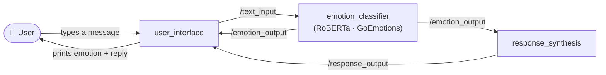

# Emotion-Aware Assistant


A modular **ROS 2** system that **detects the emotion behind a user's message** with a
**RoBERTa** model fine-tuned on Google's **GoEmotions** dataset, then **replies with an empathetic
response adapted to that emotion**.

The application is split into three independent nodes that communicate over ROS 2 topics. That
is the same publish/subscribe architecture used in robots that need to perceive a user's state
and react to it (social robots, assistive robots, conversational agents).

---

## Demo


---

## Features

- **Emotion detection with a Transformer model**: [`SamLowe/roberta-base-go_emotions`](https://huggingface.co/SamLowe/roberta-base-go_emotions)
  (RoBERTa-base fine-tuned on 28 GoEmotions labels), run locally with the Hugging Face `pipeline` API.
- **28 → 7 emotion mapping**: fine-grained labels are grouped into 7 basic emotions
  (anger, fear, joy, love, sadness, surprise, neutral) so the response logic stays simple and robust.
- **Empathetic responses**: several replies per emotion, chosen at random so the conversation
  feels less repetitive.
- **Decoupled ROS 2 architecture**: each node has a single responsibility and can be replaced
  independently (e.g. swap the reply node for an LLM, or the terminal for speech-to-text).
- **Robustness**: empty inputs, unknown labels, model errors and over-long texts are handled.
  The UI never hangs thanks to a response timeout.
- **Configurable** through ROS 2 parameters and a launch file.
- **Tested and CI-checked**: the emotion logic is pure Python, unit-tested with `pytest`, and
  linted with `flake8` in a GitLab CI pipeline.

---

## Architecture



| Node | Subscribes to | Publishes to | Role |
|---|---|---|---|
| `user_interface` | `/emotion_output`, `/response_output` | `/text_input` | Reads the user's text in the terminal, shows the detected emotion and the reply |
| `emotion_classifier` | `/text_input` | `/emotion_output` | Runs the Transformer model, keeps the top prediction and maps it to a basic emotion |
| `response_synthesis` | `/emotion_output` | `/response_output` | Picks an empathetic reply adapted to the emotion |

All topics use `std_msgs/msg/String`.

### Emotion mapping (GoEmotions → basic emotion)

| Basic emotion | GoEmotions labels |
|---|---|
| 😠 **anger** | anger, annoyance, disapproval, disgust |
| 😨 **fear** | fear, nervousness |
| 😄 **joy** | amusement, approval, excitement, joy, optimism, pride, relief |
| ❤️ **love** | admiration, caring, desire, gratitude, love |
| 😢 **sadness** | disappointment, embarrassment, grief, remorse, sadness |
| 😮 **surprise** | confusion, curiosity, realization, surprise |
| 😐 **neutral** | neutral |

---

## Tech stack

| Area | Tools |
|---|---|
| Robotics middleware | ROS 2 (`rclpy`, topics, parameters, launch files) |
| NLP / ML | Hugging Face Transformers, PyTorch, RoBERTa, GoEmotions |
| Language | Python 3 |
| Quality | pytest, flake8, GitLab CI/CD |

---

## Repository structure

```
ros2-emotion-aware-assistant/
├── emotion_aware_assistant/        # Python package (the ROS 2 nodes)
│   ├── emotions.py                 # Emotion mapping + responses (pure Python, unit-tested)
│   ├── emotion_classifier.py       # Node: text -> emotion (Transformer model)
│   ├── response_synthesis.py       # Node: emotion -> empathetic reply
│   └── user_interface.py           # Node: interactive terminal UI
├── launch/
│   └── emotion_assistant.launch.py # Starts the classifier + response nodes
├── test/
│   └── test_emotions.py            # Unit tests (pytest)
├── docs/
│   └── demo.mp4                    # Demo video
├── resource/                       # ament index marker (required by ROS 2)
├── package.xml                     # ROS 2 package manifest
├── setup.py / setup.cfg            # Python packaging + node entry points
├── requirements.txt                # pip dependencies (transformers, torch)
├── .gitlab-ci.yml                  # CI pipeline (lint + tests)
└── LICENSE
```

---

## Getting started

### Prerequisites

- Ubuntu with **ROS 2** installed (Humble or newer), see the [ROS 2 installation guide](https://docs.ros.org/en/humble/Installation.html)
- Python 3.10+
- ~1 GB of free disk space (the model is downloaded from Hugging Face on the first run)

### 1. Clone into a ROS 2 workspace

```bash
mkdir -p ~/ros2_ws/src && cd ~/ros2_ws/src
git clone https://gitlab.com/your-real-username/ros2-emotion-aware-assistant.git
```

### 2. Install the Python dependencies

```bash
pip install -r ~/ros2_ws/src/ros2-emotion-aware-assistant/requirements.txt
```

> On Ubuntu 24.04 (ROS 2 Jazzy), system-wide `pip install` is blocked. Use a virtual environment
> that can still see the ROS packages:
> `python3 -m venv --system-site-packages ~/ros2_ws/.venv && source ~/ros2_ws/.venv/bin/activate`
> and run the `pip install` above inside it (activate it in every terminal before running the nodes).

### 3. Build

```bash
cd ~/ros2_ws
source /opt/ros/$ROS_DISTRO/setup.bash
colcon build --packages-select emotion_aware_assistant
source install/setup.bash
```

### 4. Run

**Terminal 1**: start the processing nodes:

```bash
ros2 launch emotion_aware_assistant emotion_assistant.launch.py
```

**Terminal 2**: start the interactive interface (after sourcing `install/setup.bash`):

```bash
ros2 run emotion_aware_assistant user_interface
```

Then type a message and press **Enter**. Type `quit` to exit.

> The nodes can also be started one by one with `ros2 run emotion_aware_assistant emotion_classifier`
> and `ros2 run emotion_aware_assistant response_synthesis`.

### Example session

```
You: I finally got the internship I applied for!
Detected emotion: joy
System response:  I'm glad you're happy! What's the reason?
```

### Inspect the pipeline with ROS 2 tools

```bash
ros2 topic echo /emotion_output                          # watch detected emotions
ros2 topic pub --once /text_input std_msgs/msg/String "{data: 'I miss my family'}"
rqt_graph                                                # visualise the node graph
```

---

## Configuration

| Node | Parameter | Default | Description |
|---|---|---|---|
| `emotion_classifier` | `model_name` | `SamLowe/roberta-base-go_emotions` | Hugging Face text-classification model |
| `emotion_classifier` | `top_k` | `3` | Number of predictions computed (logged with their scores) |
| `user_interface` | `response_timeout` | `15.0` | Seconds to wait for a reply before warning the user |

Example:

```bash
ros2 run emotion_aware_assistant user_interface --ros-args -p response_timeout:=30.0
```

---

## Tests

The emotion mapping and response logic live in `emotions.py`, which has no ROS dependency, so it
can be tested anywhere:

```bash
python3 -m pytest test -v
```

The same tests and a `flake8` style check run automatically in **GitLab CI** on every push.

---

## Author

**Mazen Ben Abid**, Advanced Technologies Engineer